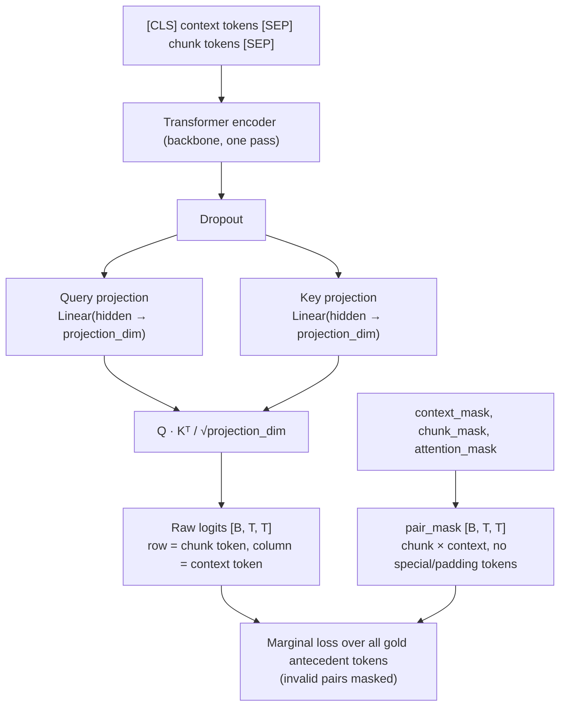
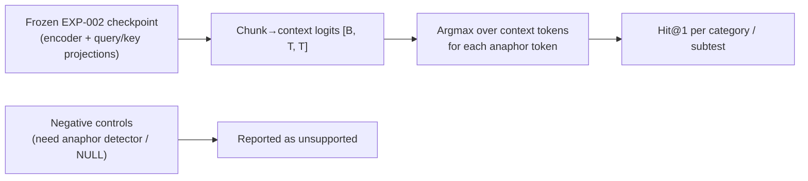
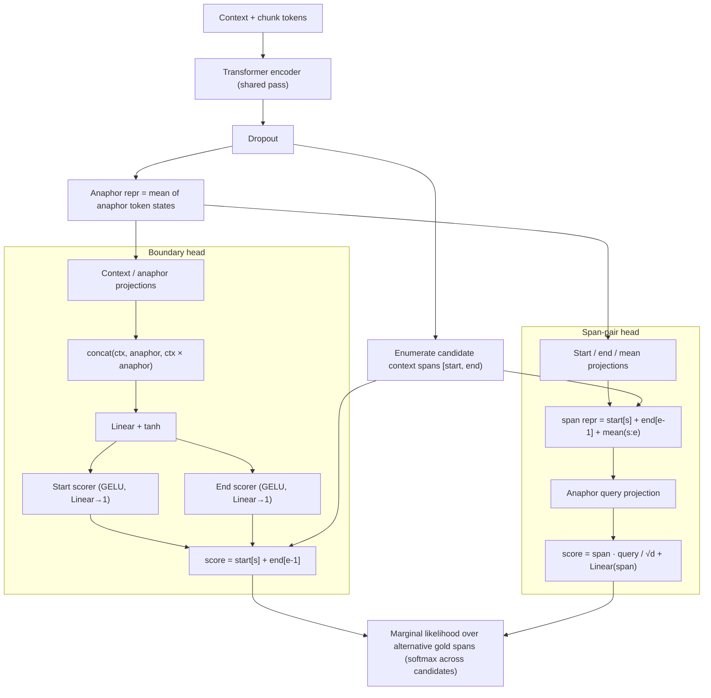
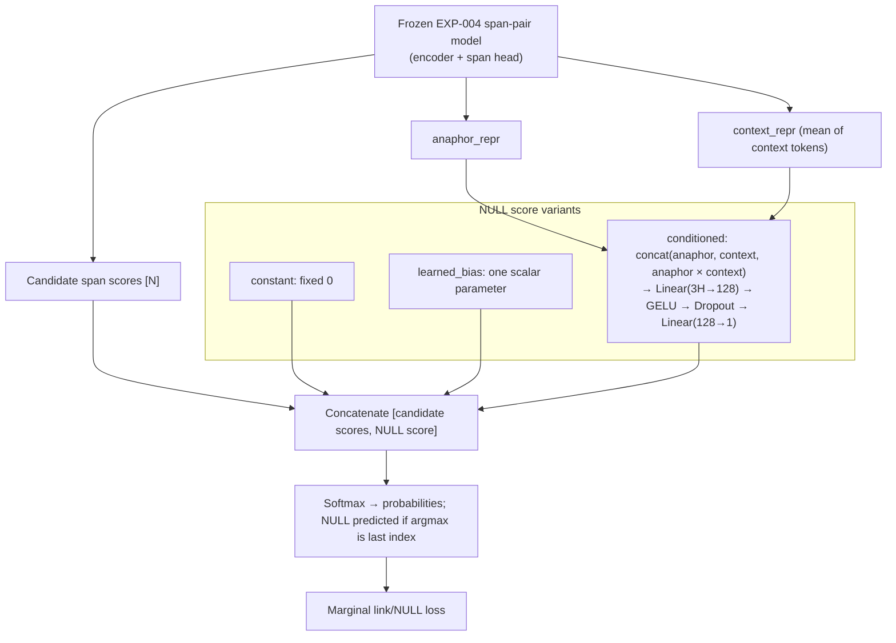
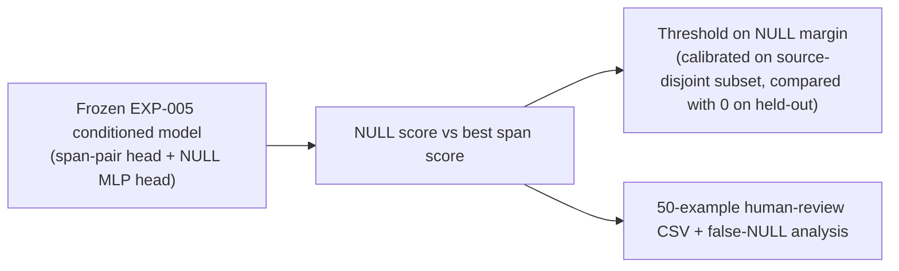

# context-gap-detection
Explores whether lightweight encoder models can detect information loss introduced by text chunking.


# Context Gaps

**Can we detect information lost when text is chunked?**

Many AI systems split documents into smaller chunks before indexing, retrieval, or downstream processing. These boundaries can remove information needed to correctly interpret the resulting text.

For example:

> **Context:** The European Commission announced a new support programme on Monday.  
> **Chunk:** *It will provide them with grants starting next year.*

The chunk is syntactically valid, but several spans depend on information outside it:

- `It` → **ENTITY_GAP**
- `them` → **ENTITY_GAP**
- `next year` → **TIME_GAP**

This project explores whether lightweight, non-generative encoder models can detect and localise these **context gaps**.

## Research Question

> Can an encoder model identify spans in a chunk whose intended interpretation depends on information available in the source context but absent from the chunk?

The goal is detection, not reconstruction. The project does not attempt to generate or fill in missing context.

## Definition of a Context Gap

A **context gap** is a span whose intended interpretation cannot be sufficiently determined from the candidate chunk, but can be determined using its source context.

The initial experiment considers three types:

| Label | Missing information |
| --- | --- |
| `ENTITY_GAP` | The intended entity or referent |
| `EVENT_GAP` | The event, action, or proposition being referenced |
| `TIME_GAP` | The temporal anchor required to interpret an expression |
| `O` | No context gap |

The taxonomy is intentionally small. The aim is to test whether the underlying phenomenon is detectable rather than to model every possible form of contextual dependency.

## Experiment

The proof of concept consists of four stages:

1. **Data** — Adapt human decontextualization annotations into a context-gap detection dataset.
2. **Models** — Train and compare two lightweight encoder-based approaches.
3. **Evaluation** — Evaluate span detection and whether predictions respond correctly when missing context is restored.
4. **Release** — Publish the dataset, best-performing model, and an interactive demo on Hugging Face.

## Data

The project starts from the human-annotated dataset introduced in [*Decontextualization: Making Sentences Stand-Alone*](https://arxiv.org/abs/2102.05169).

Human decontextualization edits provide candidate examples of information that annotators considered necessary for a sentence to stand alone. These edits are mapped into the narrower context-gap taxonomy used here.

## Evaluation

Alongside standard span-level precision, recall, and F1, the experiment will include **context intervention** tests.

A detected gap should disappear when sufficient source context is restored. This helps distinguish genuine context sensitivity from models that simply learn lexical patterns such as pronouns or relative temporal expressions.

## Project Status

- [ ] Build and validate dataset
- [ ] Train baseline encoder
- [ ] Train context-aware encoder
- [ ] Evaluate and analyse errors
- [ ] Release model and dataset
- [ ] Publish interactive Hugging Face demo

## Reference

Choi, E. et al. (2021). *Decontextualization: Making Sentences Stand-Alone*. Transactions of the Association for Computational Linguistics.


## Test battery
# Antecedent–Anaphor Diagnostic Test Battery

## A — Basic and Semantic Forms

| ID | Test | Expected Behaviour |
|---|---|---|
| A01 | Exact NP | Resolve an anaphor whose surface form exactly matches its antecedent. Establishes the basic lexical-match baseline. |
| A02 | Shortened NP | Resolve a shortened NP to a longer antecedent when only part of the antecedent is repeated, e.g. "the proposed expansion..." → "the expansion". |
| A03 | Proper-name variation | Resolve a shortened proper name to a fuller named antecedent, e.g. "Prime Minister Elena Vasquez" → "Vasquez". |
| A04 | Pronoun | Resolve a pronoun to a named antecedent despite there being no lexical overlap, e.g. "Dr. Sarah Chen" → "She". |
| A05 | Definite description | Resolve a semantically related definite description without direct lexical overlap, e.g. "Hurricane Celeste" → "the storm". |
| A06 | Demonstrative | Resolve a demonstrative NP referring to a previously described event or proposition, e.g. an action/event → "This decision". |
| A07 | Alias / acronym | Resolve an acronym or alias to its full-form antecedent, e.g. "International Renewable Energy Agency" → "IRENA". |
| A08 | Nominal reformulation | Resolve a nominal expression to an event expressed in another grammatical form, e.g. "acquired..." → "the deal". |

## B — Antecedent Competition

| ID | Test | Expected Behaviour |
|---|---|---|
| B01 | Same-type distractor | Select the correct antecedent when another entity of the same broad semantic type is present. Do not treat type compatibility alone as sufficient. |
| B02 | Lexical distractor | Select the correct antecedent when another candidate has strong lexical similarity to the anaphor. |
| B03 | Nearest-is-wrong | Resolve to the correct antecedent even when another plausible candidate occurs more recently. Tests resistance to a nearest-mention heuristic. |
| B04 | Most-frequent-is-wrong | Resolve to a less frequently mentioned entity rather than selecting the most salient entity purely because it dominates the context. |

## C — Distance

| ID | Test | Expected Behaviour |
|---|---|---|
| C01 | Adjacent | Resolve an antecedent occurring immediately before the context–chunk boundary. Establishes the easiest distance baseline. |
| C02 | Two-sentence distance | Maintain the coreference relationship across two intervening sentences when there are no strong competing antecedents. |
| C03 | Four-plus-sentence distance | Maintain the relationship across four or more intervening sentences, testing degradation as antecedent distance increases. |
| C04 | Intervening entities | Resolve a distant antecedent despite several other entities being introduced between the antecedent and anaphor. Tests distance combined with interference. |

## D — Link Structure

| ID | Test | Expected Behaviour |
|---|---|---|
| D01 | 1:1 | Correctly identify a single antecedent and single corresponding anaphor. Establishes the simplest link-structure baseline. |
| D02 | 1:N | Link multiple anaphoric mentions in the chunk to the same antecedent, including anaphors with different surface forms. |
| D03 | Two independent pairs | Correctly identify two separate antecedent–anaphor relationships without crossing links or collapsing the entities into one chain. |
| D04 | Coreference chain | Recognise multiple differently expressed context mentions as belonging to the same entity/coreference chain and connect the chunk anaphor to that chain. |

## E — Span Complexity

| ID | Test | Expected Behaviour |
|---|---|---|
| E01 | Long NP | Extract the complete long antecedent NP rather than clipping it to a shorter but semantically plausible subspan. |
| E02 | Title + name | Extract the complete title-and-name antecedent span, e.g. "Chief Inspector Rebecca Lawson", rather than only the name, surname, or title. |
| E03 | Possessive | Correctly identify and resolve a possessive anaphoric span, e.g. "Professor Adrian Keller" → "Keller's". |
| E04 | Nested / embedded NP | Select the intended antecedent span when it contains another plausible entity or NP, avoiding incorrect nested or partial span boundaries. |

## F — Reasoning

| ID | Test | Expected Behaviour |
|---|---|---|
| F01 | Syntactic cue | Use grammatical and syntactic structure to distinguish between plausible antecedents rather than relying only on proximity. |
| F02 | Semantic type | Use semantic compatibility to select the correct antecedent, e.g. recognising that "the building" can refer to a hotel rather than a railway bridge. |
| F03 | Discourse / event cue | Resolve a nominal anaphor to a preceding event or proposition based on its discourse role, e.g. "agreed to reduce tuition..." → "The decision". |
| F04 | World-knowledge stress test | Resolve a relationship requiring basic encyclopedic knowledge not explicitly stated in the supplied context, e.g. "Mount Vesuvius" → "the volcano". Failure may be acceptable for systems intentionally restricted to context-supported evidence. |

## G — Negative Controls

| ID | Test | Expected Behaviour |
|---|---|---|
| G01 | No anaphor | Produce no link when the context contains a salient potential antecedent but the chunk contains no expression referring back to it. Tests resistance to over-linking. |
| G02 | Missing antecedent | Recognise that an anaphoric expression exists in the chunk but its antecedent is absent from the supplied context. Do not invent a link to a merely plausible context span. |
| G03 | Lexical false friend | Produce no link when context and chunk contain highly similar expressions that actually refer to different entities. Tests resistance to lexical-match shortcuts. |
| G04 | Generic / non-referential NP | Do not link a generic class-level expression to a specific entity in the context, e.g. "the Green Valley solar farm" ≠ generic "Solar farms". |

## H — Contrast / Adversarial

| ID | Test | Expected Behaviour |
|---|---|---|
| H01 | Recency contrast | Select the correct antecedent despite a same-type competing entity occurring closer to the chunk boundary. Tests systematic recency bias. |
| H02 | Gender / number contrast | Respect grammatical gender and/or number when selecting among candidate antecedents, e.g. plural "They" should resolve to a coordinated pair rather than a nearby singular person. |
| H03 | Entity-order swap | Resolve based on entity identity and contextual evidence rather than the order in which candidate entities appear. Predictions should remain correct when candidate ordering is manipulated. |
| H04 | Minimal lexical change | Attend to a small but decisive lexical distinction between highly similar candidates, e.g. "Northern" vs. "Southern". A controlled change to that distinguishing token should change the selected antecedent. |

## Loading Coreference Data

```python
from src.data.datamodule import CoreferenceDataModule

datamodule = CoreferenceDataModule(
    dataset_name="YOUR_HF_DATASET",
    tokenizer_name="distilbert-base-uncased",
    batch_size=16,
)
datamodule.prepare_data()
datamodule.setup("fit")

batch = next(iter(datamodule.train_dataloader()))
assert batch["input_ids"].ndim == 2
assert batch["relations"].ndim == 3
assert batch["antecedent_spans"].ndim == 4
```

## Token Affinity Model

`CoreferenceModel` encodes the concatenated context/chunk sequence once, then
scores every potential chunk-token-to-context-token pair. Its raw `logits` have
shape `[B, T, T]`: `logits[b, i, j]` is the score for chunk token `i` against
context token `j`. The boolean `pair_mask` has the same shape and is true only
for attended chunk/context token pairs. The data preprocessor marks special
tokens as belonging to neither segment, and the attention mask excludes padding.
The model leaves invalid logits unchanged and does not apply sigmoid or softmax.

```python
from src.models.affinity import CoreferenceModel

model = CoreferenceModel(
    encoder_name="distilbert-base-uncased",
    projection_dim=128,
)

output = model(
    input_ids=batch["input_ids"],
    attention_mask=batch["attention_mask"],
    context_mask=batch["context_mask"],
    chunk_mask=batch["chunk_mask"],
)
logits = output["logits"]       # [B, T, T], chunk query -> context key
pair_mask = output["pair_mask"] # [B, T, T], boolean valid-pair mask
```

## Training

The Lightning module accepts batches from `CoreferenceDataModule` directly.
Its loss treats all annotated antecedent mentions for one relation as
alternatives, and its Hit@1 metrics evaluate antecedent-token localization
(not exact span extraction or end-to-end coreference resolution).

```python
import lightning as L

from src.data.datamodule import CoreferenceDataModule
from src.training.module import CoreferenceLightningModule

data = CoreferenceDataModule(
    dataset_name="YOUR_HF_DATASET",
    tokenizer_name="distilbert-base-uncased",
    batch_size=16,
)
model = CoreferenceLightningModule(
    encoder_name="distilbert-base-uncased",
    projection_dim=128,
    learning_rate=2e-5,
    weight_decay=0.01,
)

trainer = L.Trainer(max_epochs=3)
trainer.fit(model, datamodule=data)
trainer.test(model, datamodule=data)
```

### Full-data EXP-002

**Architecture** (`src/models/affinity.py`): a single encoder pass feeds two
linear projections; their scaled dot product gives chunk-to-context logits.



Run the reproducible full-training experiment from the repository root:

```bash
python scripts/experiments/exp002_full_training.py --offline
```

The runner trains on the full train split, selects a checkpoint using the
development split, and compares the selected model with random and recency
baselines. It loads only train/dev; the reserved test split is not used.
Configuration, metrics, and relation-level predictions are written to
`experiments/exp002_full_training/`. The checkpoint is kept in the ignored
`checkpoints/` subdirectory and should not be committed.

### EXP-003 behavioral evaluation

**Architecture**: no new layers; the frozen EXP-002 affinity model is evaluated only.



Evaluate the frozen EXP-002 checkpoint on the reserved behavioral test split:

```bash
python scripts/experiments/exp003_behavioral_eval.py
```

The runner verifies that it is loading the checkpoint recorded as best by
development loss, does not train or tune, and preserves every test example in
its audit. It writes category/subtest metrics, taxonomy mapping, relation-level
predictions, failure analysis, and a human-readable report to
`experiments/exp003_behavioral_eval/`. Negative controls that require an
anaphor detector or null-antecedent prediction are reported as unsupported,
not as correct predictions.

### EXP-004 antecedent span extraction

**Architecture** (`src/models/span_extraction.py`): all approaches share one encoder pass and score every candidate context span (up to `max_span_length`) for a given anaphor; the anaphor is the mean of its token states.



The baseline (frozen EXP-002 affinity token, optionally expanded to a spaCy noun chunk) adds no learned layers.

Compare frozen EXP-002 affinity expansion with independently trained boundary
and span-pair heads using the development split only:

```bash
python scripts/experiments/exp004_span_extraction.py --approach all --offline
```

Run one approach independently with `--approach baseline`, `boundary`, or
`span_pair`. The baseline expands to a containing noun chunk only when a local
spaCy `en_core_web_sm` model is installed; otherwise it returns the selected
affinity token and records that fallback. Learned models share one encoder
pass per batch and use marginal likelihood over alternative gold spans.
Predictions, metrics, checkpoints, and comparison reports are written to
`experiments/exp004_span_extraction/`. The runner preprocesses train/dev only;
it never uses the EXP-003 test split. Review `error_review.json` manually for
each learned approach and record error classifications before treating the
qualitative analysis as complete. Checkpoints are not intended for Git.

### EXP-005 null antecedent prediction

**Architecture** (`src/models/null_antecedent.py`): the EXP-004 span-pair model is frozen and a NULL candidate score is appended to its candidate scores before the softmax.



Compare fixed, globally learned, and context-conditioned NULL candidates using
the frozen EXP-004 span-pair checkpoint:

```bash
python scripts/experiments/exp005_null_antecedent.py --approach all --offline
```

Run one variant with `--approach constant`, `learned_bias`, or `conditioned`.
The runner requests only the train and dev dataset splits. Synthetic negatives
are created within each source split; examples with no valid relation are
audited but never promoted to NULL targets. Review the `manual_review_set`
entries in `experiments/exp005_null_antecedent/negative_generation_report.json`:
synthetic NULL labels remain heuristic until reviewed. Metrics, calibration,
paired-contrast results, predictions, and failure diagnostics are written under
`experiments/exp005_null_antecedent/`. Checkpoints are not intended for Git.

### EXP-005B NULL prediction validation

**Architecture**: no new layers; the frozen context-conditioned EXP-005 model is only evaluated.



Validate the frozen context-conditioned EXP-005 model without retraining:

```bash
python scripts/experiments/exp005b_null_validation.py --offline
```

This evaluation requests only the development split and writes the 50-example
human-review CSV, false-NULL analysis, source-grouped threshold calibration,
predictions, and comparison report under
`experiments/exp005b_null_validation/`. Human labels are intentionally left
blank and marked `PENDING`; the error-enriched sample must not be treated as
representative. Calibration selects a threshold on one source-disjoint subset
and compares it with threshold zero on the held-out subset. The EXP-005B
methodology and outcomes are appended to `EXPERIMENTLOG.md`.